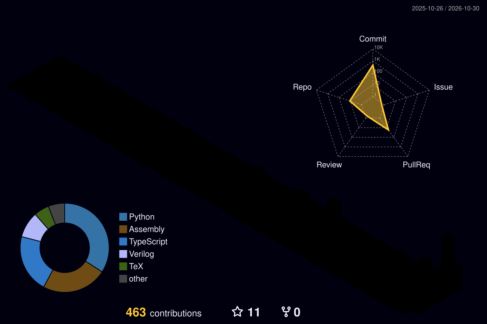

  

  B.Tech CSE @ <b>IMS Engineering College</b>, India · BS Computer Science @ <b>University of the People</b> 
  Working on <b>multi-agent systems</b>, <b>Bayesian inference</b>, small language models, hardware built from zero, and my own programming language 
  Right now: giving my from-scratch OS a macOS-style desktop, written entirely in my own language.

  
  
  
  
  
  
  
  

---

### 🧊 My contributions, in 3D

  

> Generated every day from my real GitHub contributions by a GitHub Action in this repo. It appears after the action's first run.

---

### 📊 Real numbers, live from GitHub

  
  

  

---

### 🗂️ Projects at a glance

| Project | What it is |
|---|---|
| [The Jal Pari Language](https://github.com/themythofsisyphusjayant/RED-MOON-) | A safe, simple, natively fast language built from scratch — v1.2.0, native/WASM/big32 backends, freestanding mode |
| [Black Moon OS](https://github.com/themythofsisyphusjayant/BLACK-MOON-OS-) | Arch-based Linux distro with a macOS-style look, plus JalOS, a teaching OS in Jal Pari — bootable ISO built Oct 2026 |
| [big32](https://github.com/themythofsisyphusjayant/BIG-32) | A 32-bit RISC-V CPU built from zero in Verilog, booting a Linux kernel into early driver init |
| [OpenMythos](https://github.com/themythofsisyphusjayant/onion-ai) | A miniature recurrent language model, built from scratch |
| [Nyx](https://github.com/themythofsisyphusjayant/nyx-crystal-ai) | A decision-intelligence simulator with a live demo |
| [Provenance-Aware Belief Aggregation](https://github.com/themythofsisyphusjayant/PROVENANCE-AWARE-BELIEF-AGGREGATION) | A 17-page research manuscript on multi-agent communication |
| [ASIC Puzzle 2026](https://github.com/themythofsisyphusjayant/JANE-) | A chip reverse-engineered from its GDS layout alone |
| [NYX Phoenix Migration](https://github.com/themythofsisyphusjayant/harshswarm-) | Enterprise multi-agent simulation platform — NYX migrated from Streamlit to Next.js + FastAPI, same deterministic kernel, zero logic loss |
| [Recurrent Small LMs](https://github.com/themythofsisyphusjayant/RECURRENT-SMALL-LMS) | NeurIPS-style technical report (22 pages) on recurrent small language models, loop-extrapolation evidence stated honestly |

---

### 🎓 Education

- **BS in Computer Science** — University of the People (enrolled Oct 2026; WSCUC-accredited)
- **B.Tech in Computer Science & Engineering** — IMS Engineering College (AKTU), 2026–2030

---

### 🔬 Featured work

**[Provenance-Aware Belief Aggregation in Multi-Agent Communication Under Convention Heterogeneity](https://github.com/themythofsisyphusjayant/PROVENANCE-AWARE-BELIEF-AGGREGATION)** · [beginner explainer](https://github.com/themythofsisyphusjayant/PROVENANCE-AWARE-BELIEF-AGGREGATION/blob/main/EXPLAINED_FOR_BEGINNERS.md)

When agents report through different *communication conventions* — mappings from internal readings to messages that can invert or transform the signal — weighting messages by source reliability answers the wrong question. This work proves structural limitations of scalar trust weighting and introduces a Bayesian aggregator that decodes messages through inferred latent conventions.

> *Reliability is not convention. Weighting evidence is not decoding evidence.*

- 📐 Core claim proved inside the model's assumptions (repaired Theorem 2); real-world universality is NOT claimed
- 🧪 17-page manuscript, headline runs over 190 seeds with confidence intervals, PVI-REAL human-judgment section
- 🔁 Fully reproducible: `bash reproduce.sh` regenerates tables, figures, and the paper

**[Nyx — the Decision Intelligence Simulator](https://github.com/themythofsisyphusjayant/nyx-crystal-ai)** · [live demo](https://nyx-crystal-ai.lovable.app/) · [beginner explainer](https://github.com/themythofsisyphusjayant/nyx-crystal-ai/blob/main/docs/EXPLAINED_FOR_BEGINNERS.md)

Give it a hard decision — *"should we ban smartphones in schools?"* — and Nyx builds a miniature society of AI agents that debate, feel emotions, influence each other, and occasionally crash. The output isn't just a winner but a strategic forecast: hidden risks, fragile assumptions, key influencers, what-if scenarios.

- 🎲 Fully deterministic kernel: the same seed always reproduces the same outcome — auditable and reproducible by design
- 🧠 Agents carry evolving psychological variables; advanced mode unlocks batch experiments, counterfactuals, Nash equilibria and Pareto frontiers
- 🎬 Worked example + demo GIF in the README: seed-42 smartphone-ban run, Dev cascades in rounds 4–5 then recovers

**[OpenMythos — a miniature recurrent language model](https://github.com/themythofsisyphusjayant/onion-ai)** · [44M report](https://github.com/themythofsisyphusjayant/onion-ai/blob/main/research/44m_experiment_report.md) · [beginner explainers](https://github.com/themythofsisyphusjayant/onion-ai/blob/main/research/44m-explained-for-beginners.md)

A from-scratch language model built around one question: does weight-shared recurrent iteration buy effective depth more cheaply than wider layers? **Prelude → Recurrent Block × N → Coda**, with GQA + RoPE attention, SwiGLU (or sparse MoE), and truncated BPTT.

- ✅ Verification tests passing, including KV-cache equivalence for recurrent generation
- 🧪 Stage-0 result (44M, TinyStories, one T4): loop depth 4 loss 1.484 vs depth-1 baseline 3.380 — but depth 8 is significantly worse (+0.106, 95% CI [+0.101, +0.110]). Extrapolation is scale- and task-dependent, not settled
- 📝 MiniMythos 125M (reported, not independently verified): HellaSwag 29.5% → 30.0% (8 → 16 loops), PIQA flat at 50.0% (chance)
- 🚀 1B roadmap: 1.06B config, loop-depth curriculum — a plan, not a trained model yet

**[Jane Street ASIC Puzzle 2026 — solved](https://github.com/themythofsisyphusjayant/JANE-)** · [beginner explainer](https://github.com/themythofsisyphusjayant/JANE-/blob/main/EXPLAINED_FOR_BEGINNERS.md)

Reverse-engineered a chip from its GDS layout alone, by four independent methods that all agreed. The chip is a serial-key lock: 121-bit key, flag `(* TWO STARS *)`. Published after submissions closed (4 Sep 2026); nothing was submitted. Includes a 3D viewer plotting all 728 cells at their real layout positions.

**[Recurrent Small LMs — technical report](https://github.com/themythofsisyphusjayant/RECURRENT-SMALL-LMS)**

NeurIPS-style technical report (22 pages) on recurrent small language models, with the loop-extrapolation evidence stated honestly — including where it fails.

**[The Jal Pari Language](https://github.com/themythofsisyphusjayant/RED-MOON-)**

A safe, simple, natively fast programming language built from scratch — 48 builtins, native/WASM/big32 backends, and now a freestanding mode with trap handling on the road to a from-scratch OS. v1.2.0 (Oct 2026).

**[Black Moon OS](https://github.com/themythofsisyphusjayant/BLACK-MOON-OS-)**

An Arch-based Linux distro (XFCE, macOS-style glass look) with JalOS — a teaching OS written in Jal Pari — built in. Bootable ISO built Oct 2026.

**[big32 — a 32-bit RISC-V CPU from zero](https://github.com/themythofsisyphusjayant/BIG-32)**

A 32-bit RISC-V CPU built from zero in Verilog, running its own programs and booting a Linux kernel into early driver init.

---

### 🐼 Explained for beginners

Plain-language explainers, one analogy per project, with verified vs reported vs plan-only labels:
[PVI](https://github.com/themythofsisyphusjayant/PROVENANCE-AWARE-BELIEF-AGGREGATION/blob/main/EXPLAINED_FOR_BEGINNERS.md) · [Nyx](https://github.com/themythofsisyphusjayant/nyx-crystal-ai/blob/main/docs/EXPLAINED_FOR_BEGINNERS.md) · [OpenMythos 44M](https://github.com/themythofsisyphusjayant/onion-ai/blob/main/research/44m-explained-for-beginners.md) · [MiniMythos 125M](https://github.com/themythofsisyphusjayant/onion-ai/blob/main/research/minimythos-125m-explained-for-beginners.md) · [1B roadmap](https://github.com/themythofsisyphusjayant/onion-ai/blob/main/research/1b-roadmap-explained-for-beginners.md) · [ASIC puzzle](https://github.com/themythofsisyphusjayant/JANE-/blob/main/EXPLAINED_FOR_BEGINNERS.md)

*Note: tiny8 CPU (8-bit processor built from zero in Verilog, sum 1..10 = 55 verified two ways) lives in [TINY8](https://github.com/themythofsisyphusjayant/TINY8).*

---

### 🛠️ What I work with

`Python` · `PyTorch` · `Verilog` · `NumPy` · `LaTeX` · `Git`

**Interests:** multi-agent systems · Bayesian inference · trust & reputation · small language models · collective decision-making · hardware

---

  📫 Reach me: <a href="mailto:dubeymaya787@gmail.com">dubeymaya787@gmail.com</a>

